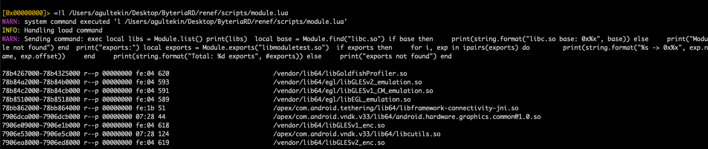
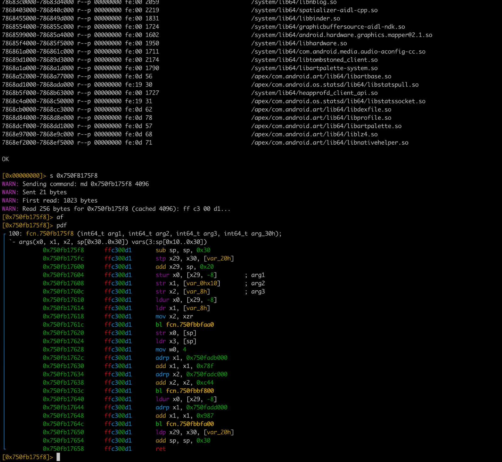
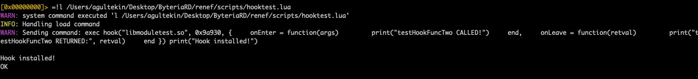
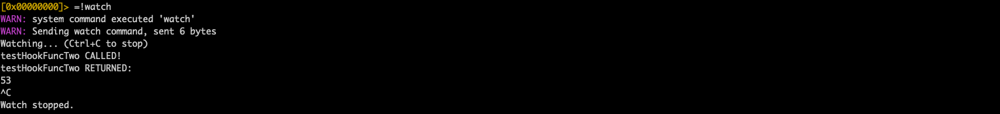
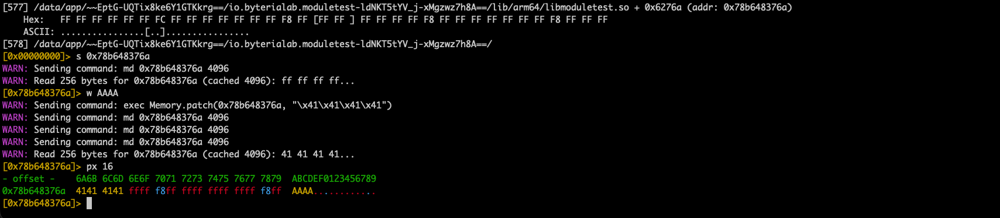

# r2renef

**Renef IO Plugin for Radare2 - Dynamic Android Instrumentation**

[](LICENSE)
[](https://rada.re)
[](https://renef.io)

---

## Overview

r2renef is a Radare2 IO plugin that bridges [Radare2](https://rada.re) with [Renef](https://renef.io), enabling powerful static analysis capabilities on live Android processes. Combine Radare2's disassembly, and scripting with Renef's dynamic instrumentation.

## Features

- **Live Memory Analysis** - Read/write process memory through Radare2 (`px`, `pd`, `pf`, `/x`, `w` ...)
- **Maps and Flags** - The target's memory ranges become io maps; modules, exports and symbols become flags
- **Hook at Cursor** - `:hook` hooks the function you are looking at; hooks show up as flags and comments
- **Java Side** - `:jc` finds classes, `:jm` lists a class's methods, `:jhook` hooks a Java method and prints its calls with decoded arguments - no Lua, no JNI signatures
- **Backtraces, Syscall Tracing, Search** - `:bt`, `:strace`, `:/x` run inside the target
- **Renef Commands** - Everything else after `:` goes to `renef_server` as is (`:exec`, `:la`, `:ms` ...)
- **Scripts** - `:l file.lua` runs a local Lua script in the target, `:watch` follows hook output

## Requirements

- [Radare2](https://github.com/radareorg/radare2) >= 5.9.0 (the plugin API used here does not exist before that; developed and tested with 6.1.4)
- [Renef](https://github.com/Byterialab/renef) running on target Android device
- Android device with ARM64 architecture
- A POSIX host (macOS, Linux, WSL)

## Installation

```bash
# Clone the repository
git clone https://github.com/ahmeth4n/r2renef
cd r2renef

# Build and install
make
make install

# Or with meson
meson setup build
ninja -C build
ninja -C build install
```

To try a build without installing it, hand the plugin file to r2 with `-I`
(it is loaded before the URI is opened):

```bash
r2 -I ./build/io_renef.dylib renef://spawn/com.example.app    # .so on Linux
```

## Quick Start

1. Start Renef server on your Android device
2. Connect via ADB port forwarding:
   ```bash
   adb forward tcp:1907 localabstract:com.android.internal.os.RuntimeInit;
   ```
3. Launch r2 with renef URI:
   ```bash
   r2 renef://spawn/com.example.app              # Spawn new process
   r2 renef://attach/12345                       # Attach by PID
   r2 renef://192.168.1.20:1907/attach/12345     # Server on another host/port
   ```

`renef_server` serves one client at a time: close the `renef` CLI (or another
r2) before connecting.

On open the plugin sets `asm.arch=arm`/`asm.bits=64`, maps the target's memory
ranges, defines a `lib.<name>` flag per module and seeks to libc.

## Usage

### Basic Commands

Once connected, use standard Radare2 commands:

```bash
[0x7f8a1c2000]> pd 20                   # Disassemble 20 instructions
[0x7f8a1c2000]> px 64                   # Print 64 bytes hex
[0x7f8a1c2000]> s lib.libssl.so         # Seek to a module
[0x7f8a1c2000]> om                      # The target's memory ranges, as io maps
[0x7f8a1c2000]> wx 1f2003d5 @ $$        # Patch (code pages are made writable by the agent)
```

### Renef Commands (`:`)

`:?` prints this list. Anything that is not one of these is sent to
`renef_server` unchanged, so `:exec`, `:la`, `:md`, `:ms`, `:hookgen <lib> <sym>`
and the rest of the Renef CLI keep working.

| Command | What it does |
|---|---|
| `:info` | connection, protocol (framed/legacy), target, read path |
| `:sync [-s] [module]` | refresh io maps and `lib.*` flags; with a module also flag its exports (`-s`: `.symtab` too) as `sym.<module>.<name>` |
| `:dm[*] [filter]` | memory ranges of the target |
| `:il[*] [filter]` | loaded modules (`xom` marks execute-only code) |
| `:ie[*] [module]`, `:is[*] [module]` | exports / `.symtab` symbols (default: the module at `$$`) |
| `:hook [addr] [-i\|-g[=lib]] [-r] [-b] [-e <lua>]` | hook the function at `addr` (default `$$`) |
| `:hooks`, `:unhook <id>\|all` | list / remove hooks; flags and comments follow |
| `:hookgen [addr]` | print a hook script template for `addr` |
| `:call <addr> [retType [arg...]]` | call the function at `addr` now and print its result; see [Calling a function](#calling-a-function) |
| `:jc [-n max] [filter]` | classes of the app whose name contains `filter` |
| `:jm [-s] [-a] <class> [filter]` | methods and constructors of a class (`-s`: with JNI signatures, `-a`: compiler-made ones too) |
| `:jhook <class> <method> [(types)] [options]` | hook a Java method; see [Java methods](#java-methods) |
| `:jni [-n] <class>` / `:jni [-n] -a [filter]` | native methods and the functions they run, flagged as `sym.jni.<Class>_<method>` |
| `:jcode <class> <method> [(types)]` | seek to the code of a Java method: its compiled code, or the function of a native method |
| `:bt[*] [addr]` | last backtrace captured by a `:hook -b` hook |
| `:strace <a,b,..> [-f lib]` | trace syscalls (`-a`, `-c <category>`, `-u`, `--list`, `--active`, `--stop`) |
| `:/x [-m module] <hex>`, `:/ [-m module] <text>` | search inside the target (`??` or `..` = any byte); hits become `renef.hit<n>` flags |
| `:l <file.lua>` | run a local Lua script in the target |
| `:watch [seconds]` | follow hook/trace output until Ctrl+C (or for the given time) |
| `:cache [flush\|<ms>]` | lifetime of cached pages (default 2000 ms) |
| `:raw <cmd>` | send `<cmd>` to the server without any interpretation |

Commands with a `*` print Radare2 commands instead: `.:il*`, `.:ie* libfoo.so`, `.:bt*`.

### Hooking from the cursor

```bash
[0x7100004140]> :hook                 # hook the function at the current seek
hook #0 installed at 0x7100004140 (libtarget.so+0x4140, inline)
[0x7100004140]> :hook sym.libc.so.open -r -b
[0x7100004140]> :watch                # Ctrl+C to stop
[hook libtarget.so+0x4140 @0x7100004140] tid=4242 x0=0x10 x1=0x20 x2=0x30 x3=0x40
[0x7100004140]> :hooks                # hit counts; also written as comments (CC)
[0x7100004140]> :bt                   # backtrace of the last call that hit a -b hook
```

`-r` also logs the return value, `-b` a backtrace per call, `-e <lua>` replaces
the default logger with your own `onEnter(args)` body.

Two kinds of hook exist and they are not interchangeable:

- **inline** (default, `-i`): the first instructions of the function are
  rewritten. Sees every call. On **execute-only** code (`xom` in `:il`, `--x`
  in `:dm`) this is what crashed targets on Renef builds without the
  execute-only fixes (before 0.4.0), so `:hook` refuses it there unless you
  pass `-i`.
- **PLT/GOT** (`-g=<lib>`, or `-g` for all libraries): only the call sites in
  `<lib>` are patched; the hooked code is not touched. The address must be
  exactly an exported symbol (the agent resolves the hook by symbol name), and
  only calls that go through the PLT of libraries loaded at that moment are
  seen - not calls from inside the library itself, not calls through function
  pointers, not libraries loaded later. The agent patches at most 64 GOT slots
  per hook, so `-g` alone on a popular libc function covers only some callers:
  name the caller.

### Calling a function

`:call` runs the function at an address right now, with the arguments you
give it, and prints what it returns - no hook, no script:

```bash
[0x7000004240]> :call sym.libc.so.strlen string "hello"
libc.so+0x4240("hello") -> 5
[0x7100004300]> :call $$ long 7 35
libtarget.so+0x4300(7, 35) -> 42
```

`retType` (`void`, `bool`, `string`, `float`, `double`, `int`, `long` or
`pointer`, default `pointer`) is only needed to pass arguments - write
`pointer` if you do not care about it. Up to 8 arguments: one that reads as a
number is passed as one; anything else, as a string. Quote an argument
(`"..."`) to force it to be a string even when it looks like a number - there
is no other way to tell `:call 0x1234 string 42` from `:call 0x1234 string
"42"` apart. Like every other argument in this file, a token cannot contain a
space.

A failed call (the address is not mapped, not inside a loaded library, not
executable, or the callee itself errors) prints why instead of a result.
`:call` never writes to the target's code - it is safe to use on
execute-only (`xom`) functions that `:hook -i` would refuse.

### Java methods

The Java side needs no script and no JNI signature:

```bash
[0x7100004140]> :jc pin                       # classes of the app, by name
com.example.app.auth.PinManager
[0x7100004140]> :jm PinManager                # the short name is enough when it is unique
class com.example.app.auth.PinManager extends java.lang.Object
  new PinManager(String)
  boolean check(String)
  boolean check(String, int)
  static native boolean verifyNative(byte[])
[0x7100004140]> :jhook PinManager check       # every `check`; (String) picks one
hook j0 installed: boolean check(String)
hook j1 installed: boolean check(String, int)
[0x7100004140]> :watch
[j0] PinManager.check("1234") -> false
[j1] PinManager.check("4821", 3) -> true
```

Strings, numbers, booleans and `byte[]` are printed with their content, so
hooks on crypto classes show keys and data as they pass:

```bash
[0x7100004140]> :jhook javax.crypto.spec.SecretKeySpec new (byte[], String)
[j2] new SecretKeySpec(byte[16] 3a9f01c2…, "AES")
```

| Option | Effect |
|---|---|
| `(types)` | one overload, written as in Java: `(String, int)`, `()` for no parameters |
| `-r <value>` | return this instead: `true`/`false`, a number, `"text"` or `null` |
| `-k` | do not run the original at all (for checks that throw; with `-r` that value is returned) |
| `-b` | log the Java stack on every call |
| `-n <N>` | stop printing after N calls; the hook stays and keeps counting |
| `-s` | print other objects with `toString()` and show the receiver of the call |
| `-e <lua>` | body of `onEnter(args)` instead of the logger |

`<method>` `new` is the constructor. `:hooks` lists Java hooks as `[jN]` with
their call counters and `:unhook jN` removes one.

#### From a Java method to its code

A `native` method is declared in Java and implemented in a library. `:jni`
finds the function behind it - also when the library registered it at run
time and exports no `Java_...` name for it:

```bash
[0x7100004140]> :jni PinManager
com.example.app.auth.PinManager
  0x7100004200   libtarget.so+0x4200          static native boolean verifyNative(byte[])
                 sym.jni.PinManager_verifyNative
1 native method: 1 bound
[0x7100004140]> s sym.jni.PinManager_verifyNative
[0x7100004200]> pdf                           # ...and :hook works on it as on any function
```

`:jni -a` does this for every class of the app. A method nothing is bound to
yet is looked up by its JNI name in the app's own libraries; if no library
exports it, it has no function until its library is loaded.

`:jcode <class> <method>` seeks to the machine code ART runs for a Java
method (`pd`, `pdf`): ahead-of-time compiled code in an `.oat`/`.odex` file or
code the JIT produced. A method that has none yet runs in the interpreter and
there is nothing to seek to.

Both need Renef 0.4.0 or later (`Java.methodInfo`).

Good to know:

- Other objects are printed as `Class@id`. `toString()` is not called unless
  you ask with `-s`: it runs code of the app, inside the hook.
- `:jc` lists the classes of the app's own dex files. Framework classes are
  not listed but can be named (`:jm java.io.File`); a few common packages are
  tried for a bare name (`:jm File`, `:jhook Activity onResume`). Classes that
  a protector loads at run time through its own class loader are not found.
- Interface and abstract methods have no code to hook: hook the class that
  implements them. A method carries one hook at a time.
- A hook whose counter in `:hooks` stays at 0 while the method obviously runs
  has most likely been inlined into its callers by ART.
- `float` and `double` parameters reach the method unchanged but are printed
  as `<float>` / `<double>`; only the first seven other parameters are shown.
- radare2 treats `~`, `;`, `|` and `@` specially: write a `-e` body that needs
  them into a file and load it with `:l`.
- Needs Renef 0.4.0 or later on Android 12 or later for hooks that survive
  exceptions and garbage collection.

### Reading memory

`md` is the only read command every `renef_server` has; it returns an ASCII
dump of at most 4096 bytes. On a framed connection, when the target lets Lua
open `/proc/self/maps`, the plugin reads through `Memory.read` instead (plain
hex, up to 32KB per request). `Memory.read` dereferences the address without
any guard, so the snippet only reads what the map says is readable, and the
path is not trusted until one page read through it matched `md`. `:info` shows
which path is in use; `RENEF_READ=md` forces `md`, `RENEF_READ=lua` the Lua
path (also on a legacy server, where it is slow - see Protocol).

**Execute-only code** (`--x` in `:dm`, `xom` in `:il`) cannot be read from
inside the target at all: neither `Memory.read` nor the agent's `md` may touch
it. A `renef_server` that has `memdump <pid> <start>-<end>` reads those pages
from `/proc/<pid>/mem` itself, and the plugin uses that for them, so system
libraries with execute-only text disassemble like any other code. `:info`
shows it as `xom reads`. On a server without that command (Renef before 0.4.0) such
pages read as `ff`.

On a server before 0.4.0, `md` output can be wrong while a hook is printing: the
agent sends the dump and the hook output over the same socket, and the server
takes whichever bytes arrive first for the dump. Renef builds where `md` reads
`/proc/<pid>/mem` in the server do not have this problem; on an older one,
remove printing hooks (or stop the trace) before trusting what you read.

Pages are cached for `RENEF_CACHE_MS` (2000 ms) and the cache is dropped after
every write and every `:` command that can change the target.

Radare2's own search (`/x`, `/`) reads every io map through the plugin, which
on a real app means gigabytes over the socket. Use `:/x` and `:/` instead:
they search inside the target and only send back the hits.

Memory mapped after the last sync (a library loaded later) is not in the io
maps yet: run `:sync`.

### Configuration

| Variable | Default | Meaning |
|---|---|---|
| `RENEF_HOST`, `RENEF_PORT` | `127.0.0.1`, `1907` | server address (the URI can carry it too) |
| `RENEF_FRAMING` | `auto` | `auto` probes the server; `off` forces the legacy protocol, `on` framing |
| `RENEF_TIMEOUT` | `35` | seconds without any data before a request is given up on |
| `RENEF_SPAWN_TIMEOUT` | `60` | seconds to wait for spawn/attach |
| `RENEF_CONNECT_TIMEOUT` | `5` | seconds to wait for the TCP connection |
| `RENEF_PROBE_TIMEOUT_MS` | `3000` | how long the framing probe waits for any answer |
| `RENEF_READ` | `auto` | `auto`, `lua` or `md` (see above) |
| `RENEF_CACHE_MS` | `2000` | page cache lifetime, `0` = off |
| `RENEF_MAPS` | `ranges` | `ranges`: one io map per range; `full`: keep Radare2's single map over everything |
| `RENEF_NOSYNC` | unset | `1`: do not sync maps/flags or seek on open |
| `RENEF_LEGACY_FIRST_MS`, `RENEF_LEGACY_QUIET_MS` | `8000`, `400` | legacy protocol only: wait for the first byte / silence that ends a reply of unknown shape |

### Protocol

Renef builds with request framing answer each request with an end marker
(`@req <id> <len>` / `@done <id>`), so a reply ends exactly where it ends and a
reply that arrives after its request was given up on is skipped. The plugin
probes for this on connect and otherwise falls back to the legacy protocol of
older Renef (before 0.4.0), where a reply is "whatever arrives until the line goes
quiet". There the plugin recognises the end of the replies it knows (`md`,
`exec`, one-line replies), and resynchronises with a `ping` after a timeout.

A server before 0.4.0 also stays inside its `exec` handler for about five seconds
after every script (it waits for a completion text the agent does not send),
and reads no further command meanwhile. Reads use `md` there, which has no
such wait, but everything built on `exec` - the sync on open, `:hook`, `:sync
<module>`, writes - takes those seconds per request.

**Hook output.** Renef builds with an event channel keep what hooks and the
syscall tracer print apart from command replies: it waits on the server until
`:watch` asks for it (first what has been waiting, then live). Every other
command shows only its own output, plus one line when something is waiting:

```
[0x7b0a45af0c]> :hooks
Active hooks: 1
  [0] target=0x7b0a45af0c hits=820
known to r2renef:
  [0] 0x7b0a45af0c libtarget.so+0x4f0c inline hits=820
(334 lines of hook output waiting, :watch shows them)
```

`hits` comes from the agent's own counter, so it is exact even when the
server had to drop old lines of a busy hook. `^C` ends `:watch` between two
fetches, so nothing that was already taken from the server is lost.

On servers without the event channel (Renef before 0.4.0), output that nobody
asked for is shown on stderr around the next command, never inside that
command's own output, and `hits` is counted from the hook lines that were
seen.

## Screenshots

<p align="center">
  
</p>
<p align="center"><em>Renef commands in action</em></p>

<p align="center">
  
</p>
<p align="center"><em>Decompilation with `pdf` command</em></p>

<p align="center">
  
</p>
<p align="center"><em>Loading Lua hook script with `:l` command</em></p>

<p align="center">
  
</p>
<p align="center"><em>Watching hook callbacks with `:watch` command</em></p>

<p align="center">
  
</p>
<p align="center"><em>Memory patching with `w` command</em></p>

## Example Session

```bash
$ r2 renef://spawn/com.example.app
INFO: renef: connected to 127.0.0.1:1907, framed protocol
INFO: renef: spawned com.example.app, pid 12345
INFO: renef: 2315 ranges, 287 modules

[0x7f8a1c2000]> :il libssl
0x0000007f9b3c1000 - 0x0000007f9b43a000 xom libssl.so /system/lib64/libssl.so

[0x7f8a1c2000]> :sync libssl.so
2315 ranges, 287 modules, 1984 io maps
455 exports of libssl.so flagged

[0x7f8a1c2000]> pd 4 @ sym.libssl.so.SSL_write
[0x7f8a1c2000]> :hook sym.libssl.so.SSL_write -g=libmyapp.so
[0x7f8a1c2000]> :watch
```

(Addresses and counts are illustrative.)

## Testing

```bash
make unit          # parsers, framing reader, socket layer (no r2, no device)
make integration   # real r2 + the built plugin + tests/mock_renef_server.py
make test          # both
```

The integration tests load the plugin with `r2 -I` (nothing is installed) and
talk to a mock server on a free port, in framed and in legacy mode. The mock
runs the Lua the plugin sends in a real interpreter, so it needs `lua` (5.4+)
on `PATH` or in `$LUA`.

## Roadmap

- [x] Basic IO (read/seek)
- [x] Renef command passthrough (`:`)
- [x] Script loading (`:l`)
- [x] Hook watch (`:watch`)
- [x] Memory write support
- [x] Maps/flags integration
- [x] Hook at cursor, backtraces, syscall tracing, search offload
- [ ] Debug plugin (breakpoints, stepping)
- [ ] Register access

## Related Projects

- [renef](https://github.com/Byterialab/renef) - Dynamic Instrumentation Toolkit for Android
- [radare2](https://github.com/radareorg/radare2) - Reverse Engineering Framework
- [r2frida](https://github.com/nowsecure/r2frida) - Radare2 + Frida integration (inspiration)

## Contributing

Contributions are welcome! Feel free to open issues or submit pull requests.

## License

MIT License - see [LICENSE](LICENSE) for details.

